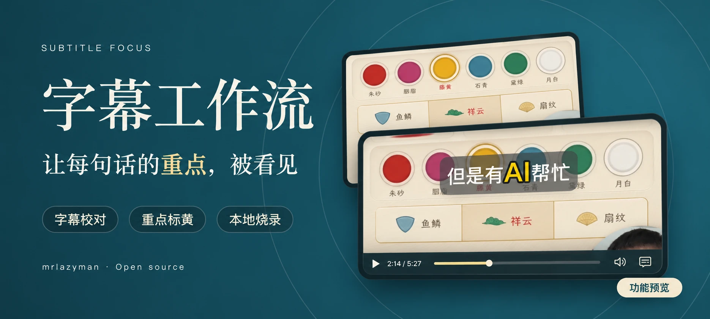
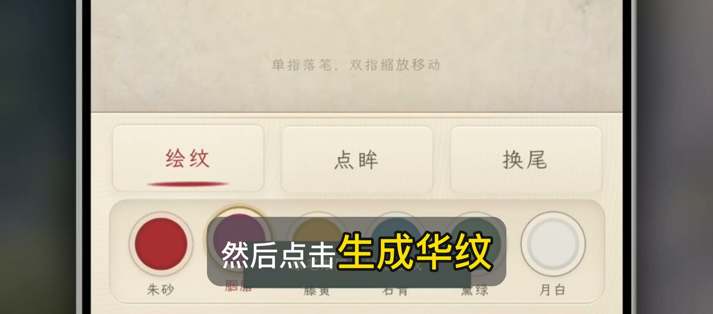
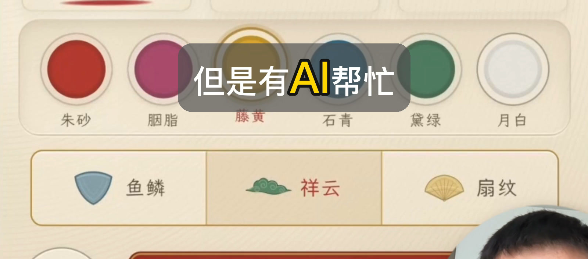
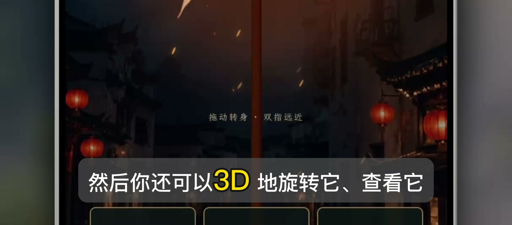
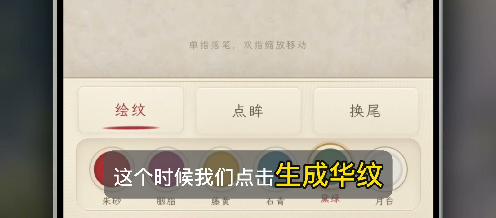
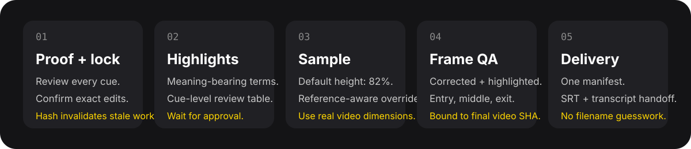

<p align="right">
  <strong>English</strong> · <a href="./README.zh-CN.md">简体中文</a>
</p>

<p align="center">
  
</p>
<p align="center"><sub>AI-illustrated cover; see the real screenshots below for the actual interface.</sub></p>

<p align="center">
  <a href="./LICENSE"></a>
  <a href="https://www.python.org/"></a>
  <a href="https://ffmpeg.org/"></a>
  
</p>

**Subtitle Focus** is an Agent Skill for generating yellow semantic highlights and burning approved subtitles into the final video. Starting from a timestamped SRT and source video, it focuses on three results:

1. **Yellow semantic highlights** — mark complete meaning-bearing words or phrases, then show the complete timeline with editable yellow marks in the local review page.
2. **Optional style calibration** — when a reference screenshot is supplied, derive a project-specific caption position, font sizing, and safe width while keeping a consistent caption-card treatment.
3. **Confirmed burn-in** — render a short sample first and burn the complete video only after the user approves the text, highlights, and sample.

The reference image guides project-level calibration; it is not a promise of pixel-perfect reproduction. Glossaries only propose exact corrections and never edit subtitle text without confirmation. The workflow deliberately starts from an exported SRT: it does not transcribe video, call Video Use, run local ASR/OCR, or infer timestamps from a plain MD transcript. Full-video burn-in runs locally and requires Python, FFmpeg, and FFprobe.

## Real output

These are cropped frames from a real 2160×3850 fish-lantern production. They show the coordinated caption card, mixed-script layout, and semantic highlights after sample approval and full-video burn-in. The screenshots are taken from the final rendered video; only the caption area is cropped.

<p align="center">
  
</p>

<p align="center">
  
</p>

<p align="center">
  
</p>

The renderer keeps Chinese and Latin on one baseline, enlarges only highlighted runs, and draws each run as a whole string so outlines do not collide. A supplied reference screenshot can change the project layout without changing the bundled default for later videos.

## Why the workflow locks text first

A one-word correction can invalidate every derived artifact. In the production above, both cue 2 and cue 35 needed the exact term **生成华纹**. The current workflow stores the SRT SHA-256 in the lock and caption plan; any byte change makes stale plans, samples, renders, and deliveries fail closed.

<p align="center">
  
</p>

## Five confirmation gates

<p align="center">
  
</p>

1. **Proof + lock** — review every cue, apply only confirmed exact-text corrections, then lock the SRT by hash.
2. **Highlights** — choose complete meaning-bearing words or phrases, then open the complete interactive review page with yellow marks; keep every adjacent pair from going completely plain unless the user explicitly confirms a targeted plain-caption exception.
3. **Style + sample** — keep the default vertical position at 82%, or derive a versioned project override from a supplied reference screenshot; then render a short sample for approval.
4. **Burn + frame QA** — after sample approval, burn the complete video and extract every corrected cue, every highlighted segment, and entry/middle/exit frames from that final render.
5. **Delivery** — write one manifest with video, SRT, plan, style, correction, review, and handoff hashes.

The Skill stops for human approval after text corrections, highlight selection, and the short sample. It never proceeds from a style reference directly to a full-video render.

Highlight continuity is deterministic: at most one rendered caption segment may remain plain in a row. A fully parenthetical aside stays plain automatically. When the user explicitly says a PiP, offscreen line, or any specific cue/segment must stay plain, that choice outranks cadence and is recorded with its target and reason; the exception separates cadence runs, and the Agent cannot infer one on its own. Highlights must be complete words, product names, or meaningful phrases; the Skill must not split a word to satisfy a percentage or choose filler merely to satisfy cadence. A short sentence may be highlighted in full when the entire sentence is one semantic point. A longer sentence normally keeps one primary phrase, or two only for a genuine parallel or contrast. Coverage never blocks validation or rendering; dense highlighting in a longer segment appears as a non-blocking warning in the optional `review` diagnostic.

## Layered glossaries

The public repository contains one populated glossary: the 350-entry base pack, with 307 Chinese confusion forms and 43 high-frequency Latin/product variants. Keep reusable personal terms in `~/.config/subtitle-focus/glossary.json`, and pass current-production terms—including any AI product vocabulary—through a project glossary. Personal and project glossaries start empty, stay user-controlled, and are not requested during installation.

The base pack references the Apache-2.0 [pycorrector](https://github.com/shibing624/pycorrector) and [macro-correct](https://github.com/yongzhuo/macro-correct) projects without importing either dictionary wholesale. See the [source and exclusion policy](./skill/references/glossary-sources.md).

```text
project > legacy custom > personal > base
```

Glossaries contain known-wrong forms and canonical suggestions. They never rewrite SRT text automatically. A project entry overrides lower layers only when it targets the same exact wrong form, and every review row records its source.

Before Gate 1, the user must explicitly choose to use or skip both the personal and project glossary layers. This records the decision without forcing either file to exist. The review shows logical layer names and hashes, not glossary absolute paths or user-defined names.

The project deliberately has no general capitalization, number/unit, pronoun, punctuation, or CJK/Latin spacing engine. Add only real, enumerated corrections requested by users. Existing mixed-script segmentation and baseline rendering remain unchanged.

```bash
python3 skill/scripts/subtitle_focus.py glossary-init --scope personal
python3 skill/scripts/subtitle_focus.py glossary-init \
  --scope project --output /abs/project-glossary.json
```

## Install

```bash
git clone https://github.com/manwithshit/subtitle-focus.git
cd subtitle-focus

# Codex / compatible agent runtimes
ln -s "$(pwd)/skill" ~/.agents/skills/subtitle-focus

# Claude Code
ln -s "$(pwd)/skill" ~/.claude/skills/subtitle-focus
```

The symlink name must match the `name` in [skill/SKILL.md](./skill/SKILL.md).

Packaged artifact: [dist/subtitle-focus.skill](./dist/subtitle-focus.skill).

### Requirements

- Python 3.9+
- Pillow with FreeType
- `ffmpeg` and `ffprobe` with the `overlay` filter
- A modern browser for interactive review; Obsidian is optional

```bash
python3 skill/scripts/subtitle_focus.py doctor
```

## First successful run

```bash
SCRIPT=skill/scripts/subtitle_focus.py
WORK=/abs/work

python3 "$SCRIPT" proofread \
  --srt /abs/input.srt \
  --no-personal-glossary \
  --no-project-glossary \
  --output "$WORK/text-review.md"

# Draft corrections.json only after reviewing SRT context, glossary provenance,
# project evidence, and user corrections.
python3 "$SCRIPT" correct \
  --srt /abs/input.srt \
  --corrections "$WORK/corrections.json" \
  --output "$WORK/locked-text.srt" \
  --review "$WORK/corrections-review.md"

# Run only after the user confirms the correction table.
python3 "$SCRIPT" lock \
  --srt "$WORK/locked-text.srt" \
  --output "$WORK/srt-lock.json" \
  --confirmed

python3 "$SCRIPT" plan \
  --srt "$WORK/locked-text.srt" \
  --lock "$WORK/srt-lock.json" \
  --output "$WORK/caption-plan.json"

python3 "$SCRIPT" apply \
  --plan "$WORK/caption-plan.json" \
  --highlights "$WORK/highlight.json" \
  --output "$WORK/caption-plan.highlighted.json"

python3 "$SCRIPT" review-web \
  --plan "$WORK/caption-plan.highlighted.json" \
  --output-dir "$WORK/review" \
  --video /abs/input.mp4

# After user confirmation, read active_version from review/session.json.
# Example for v001; use the actual current version.
APPROVED_PLAN="$WORK/review/v001/caption-plan.json"

python3 "$SCRIPT" validate \
  --plan "$APPROVED_PLAN" \
  --video /abs/input.mp4
```

Show the correction table first. At Gate 2, open the interactive webpage. Only user confirmation followed by successful local archiving permits sample rendering.

## Reference-demo layout

The bundled default remains `center_y_ratio: 0.82`. A supplied demo screenshot creates a project-specific, versioned style instead of changing that default.

```bash
python3 "$SCRIPT" style \
  --base skill/assets/default-style.json \
  --reference-image /abs/demo.png \
  --center-y-ratio 0.73 \
  --safe-width-ratio 0.76 \
  --font-size-max 88 \
  --output "$WORK/style-v1.json"

python3 "$SCRIPT" preview \
  --video /abs/input.mp4 \
  --plan "$APPROVED_PLAN" \
  --style "$WORK/style-v1.json" \
  --cue 2 \
  --output "$WORK/cue-2.png"

python3 "$SCRIPT" validate \
  --plan "$APPROVED_PLAN" \
  --video /abs/input.mp4 \
  --style "$WORK/style-v1.json"
```

The style stores the reference image path, SHA-256, dimensions, base-style SHA, and explicit overrides.

If the layout reserves a fixed caption strip, add `--band-top-ratio` and `--band-bottom-ratio` (edge pixels ÷ video height). Captions that would leave the strip fail at `validate`, before any sample is rendered, and `validate` reports the smallest top/bottom margins. Full renders copy an AAC source track unchanged instead of re-encoding it.

## Render, review, deliver

```bash
python3 "$SCRIPT" render \
  --video /abs/input.mp4 \
  --plan "$APPROVED_PLAN" \
  --style "$WORK/style-v1.json" \
  --output "$WORK/final-subtitled.mp4"

python3 "$SCRIPT" frames \
  --video "$WORK/final-subtitled.mp4" \
  --already-burned \
  --plan "$APPROVED_PLAN" \
  --style "$WORK/style-v1.json" \
  --corrections "$WORK/corrections.json" \
  --output-dir "$WORK/review-frames"

python3 "$SCRIPT" deliver \
  --video "$WORK/final-subtitled.mp4" \
  --srt "$WORK/locked-text.srt" \
  --plan "$APPROVED_PLAN" \
  --style "$WORK/style-v1.json" \
  --corrections "$WORK/corrections.json" \
  --review-dir "$WORK/review-frames" \
  --output "$WORK/delivery.json"
```

`frames` produces full-resolution PNGs, `contact-sheet.jpg`, `index.md`, and `index.json`. `deliver` rejects corrected cues without frames and rejects review evidence from a different final-video SHA.

Optional handoff can copy the final SRT, generate a transcript, copy an existing publishing document, and copy the video only when `--copy-video` is explicit. Existing files are never overwritten.

## Commands

| Command | Job |
| --- | --- |
| `doctor` | Check Pillow, fonts, FFmpeg, FFprobe, and overlay support |
| `glossary-init` | Create an editable empty personal or project glossary |
| `proofread` | Build a cue-by-cue review from layered, sourced glossary suggestions |
| `correct` | Apply confirmed exact-text changes without changing timecodes |
| `lock` | Freeze the approved SRT by hash |
| `plan` | Segment a locked SRT |
| `apply` / `review` | Apply highlights / generate an optional diagnostic |
| `review-web` | Edit highlights in a local webpage, confirm, archive and generate a sample |
| `style` / `preview` | Derive and inspect a versioned layout |
| `render` | Burn the subtitle overlay |
| `frames` | Extract final-video correction and highlight evidence |
| `deliver` | Register the one authoritative delivery and optional handoff |

Schemas and visual rules:

- [SRT text lock](./skill/references/text-lock-schema.md)
- [Highlight plan](./skill/references/highlight-schema.md)
- [Reference-demo calibration](./skill/references/style-calibration.md)
- [Visual contract](./skill/references/visual-spec.md)
- [Delivery manifest](./skill/references/delivery-schema.md)

## Verify the repository

```bash
python3 -m unittest discover -s tests -v
python3 -m py_compile skill/scripts/subtitle_focus.py skill/scripts/subtitle_review.py
python3 scripts/build_skill_package.py
```

The regression suite covers highlight cadence, parenthetical and user-confirmed plain-caption exceptions, conflict handling, full short-sentence highlighting, non-blocking long-sentence density warnings, real-pixel auto-fit on vertical video, the single 350-entry public glossary boundary, explicit glossary choices, SRT preservation, plain-MD rejection, a real FFmpeg end-to-end render, stale-SRT rejection, reference provenance, frame QA, final-video hashes, and handoff generation.

## Defaults and limits

| Token | Default |
| --- | --- |
| Font | System PingFang SC Medium |
| Body size | Starts at 4.8% of frame height and auto-shrinks to the safe width |
| Caption center | 82% of frame height |
| Highlight | 1.34× body, `#FFD600`, dark outline |
| Highlight cadence | At most one consecutive plain caption segment; explicit user-confirmed plain exceptions outrank cadence |
| Highlight density | Never blocks; short atomic captions may be 100% highlighted, while dense long captions receive a review warning |
| Bubble | `#505050`, 69% opacity, 28% padding, 40% corner |

- Source SRT and video are never replaced.
- A timestamped SRT is required. Plain MD and video-only inputs stop before Gate 1.
- No Video Use, 剪口播, Whisper, ASR, or OCR is invoked.
- Personal and project glossary use must be explicitly selected or skipped at Gate 1.
- Local glossary filenames matching `personal-glossary.json`, `project-glossary.json`, or `*.private-glossary.json` are ignored by Git.
- Corrections preserve unmentioned SRT line breaks and repeated spaces; mixed-script layout is derived later without rewriting the lock.
- The renderer needs a CJK-capable font.
- Full-length 4K-class encodes take time; the sample gate exists to catch layout errors first.
- The repository ships no source footage. The README contains cropped final-output frames only.
- Audio mixing is intentionally outside this Skill.

## License

[MIT](./LICENSE)

## Local web review and optional Obsidian traceability

`review-web` opens a loopback-only review service. Click words or drag to mark yellow, undo/redo, and save drafts. Only the user's **确认并生成样片 (Confirm and generate sample)** action publishes a complete versioned bundle: exact Unicode character ranges, source SRT snapshot, highlighted plan, receipt, and a Markdown record with yellow marks and timecodes. Obsidian is **not required**: choose any writable local project folder with `--output-dir`; the page shows this archive directory. If you use Obsidian, select a folder inside its vault. The SRT snapshot preserves original text and timing; yellow styling is retained separately in `highlights.json`, the plan and the readable Markdown record. Without `--video`, the button says **确认并保存 (Confirm and save)** and only saves the archive. Drafts, backup exports and QA receipts are not production approval. Source/plan changes and stale tabs are rejected; duplicate submissions are idempotent.

With `--video`, confirmation generates a short sample locally; the page shows the result. Full-video rendering still requires sample acceptance. No cloud upload or chat wakeup is required or promised. See [the review contract](skill/references/web-review.md) for restart, privacy, recovery and testing.
